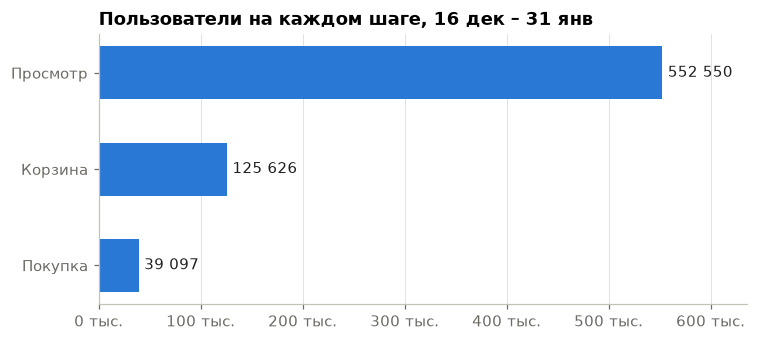
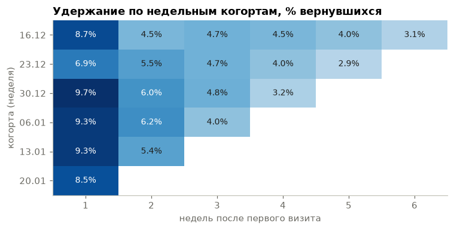

# Cosmetics Store Events: Data Cleaning, Funnel Analysis and A/B Testing

## Вопросы
1. Насколько можно доверять событийным данным магазина?
2. Где пользователи теряются на пути «просмотр → корзина → покупка»?
3. Как удерживаются покупатели по когортам?
4. Как проверить улучшение на слабом шаге воронки A/B-тестом и сколько людей и времени для этого нужно?
5. Стоит ли переносить «ворота» в игре Cookie Cats с 30-го уровня на 40-й?

**Воронка** в этом проекте — путь покупателя: посмотрел товар → положил в корзину → купил.

## Данные
| Набор | Период | Источник |
|---|---|---|
| eCommerce Events History in Cosmetics Shop (REES46) | дек 2019 – янв 2020 | [Kaggle](https://www.kaggle.com/datasets/mkechinov/ecommerce-events-history-in-cosmetics-shop) |
| Cookie Cats A/B test | 90 189 игроков | [Kaggle](https://www.kaggle.com/datasets/yufengsui/mobile-games-ab-testing) |

Таблица `events`: 7 798 038 событий, 725 736 пользователей. Одна строка — одно действие: `view`, `cart`, `remove_from_cart`, `purchase`.

**Стек:** SQL (DuckDB), Python (pandas, scipy, statsmodels, matplotlib), Jupyter.

## Качество данных

Подробный разбор с запросами — в [`notebooks/01_data_quality.ipynb`](notebooks/01_data_quality.ipynb), запросы отдельно — в [`sql/01_quality.sql`](sql/01_quality.sql).

| Что нашли | Масштаб | Что делаем |
|---|---|---|
| Пропуски `category_code` | 98% строк | категории сравниваем по `category_id`, он заполнен полностью |
| Пропуски `brand` | 42% строк | это незаполненный каталог, а не сбой записи; выводы по брендам — только среди товаров с известным брендом, доли брендов в выручке не считаем |
| Два бренда у одного товара | 21 товар | похоже на исправленную ошибку каталога (`candy` до 13 декабря); берём последний бренд |
| Точные дубли событий | 408 960 лишних строк (5,2%), 91% из них — `remove_from_cart` | исходные данные не меняем, для анализа убираем дубли; воронку по пользователям они не меняют |
| Нулевые и отрицательные цены | 15 212 и 57 событий | выручку и среднюю цену считаем только по ценам больше нуля |
| Покупки без добавления товара в корзину | 9,7%, в начале декабря около 30% | часть корзин была в ноябре, которого нет в данных; воронку считаем не с 1 декабря, а когда доля устоялась |
| Сессии с несколькими `user_id` | 128 сессий, 0,01% событий | похоже на выдачу новых ID одному посетителю, хотя часть может быть разными аккаунтами; в анализе по сессиям не учитываем |
| Спад 31 декабря и меньше событий по субботам | — | обычное поведение, не сбой; A/B-тест держим полными неделями |
| Всплеск 27–28 января | около +60 тыс. событий в день | причина неизвестна, дубли объясняют только малую часть |

**Итог:** данным можно доверять для анализа пути покупателя и удержания, если убрать дубли и некорректные цены и учесть, что ноябрь в данные не попал.

## Очистка

Подробно — в [`notebooks/02_cleaning.ipynb`](notebooks/02_cleaning.ipynb): для каждого правила записаны причина, допущение и риск. Запрос — [`sql/02_clean.sql`](sql/02_clean.sql), результат — таблица `events_clean` (7 389 078 событий).

- убраны 408 960 точных дублей;
- бренд восстановлен по тому же товару, у 21 товара взят последний бренд;
- 128 сессий с несколькими `user_id` не удалены, а помечены флагом — воронка с ними и без совпадает до сотых;
- таблица по дате не обрезана: если обрезать с 16 декабря, пропадают корзины 1–15 декабря, и покупок «без корзины» в первую неделю становится 19% вместо 9%. Поэтому окно анализа — с 16 декабря, а 1–15 декабря остаются историей.

## Ключевые выводы

**Воронка** ([`03_funnel_retention.ipynb`](notebooks/03_funnel_retention.ipynb)), 16 декабря – 31 января:



- больше всего людей теряется между просмотром и корзиной: в корзину кладут 22,74% тех, кто смотрел товары (552 550 → 125 626);
- из корзины покупает 31,12%, но внутри одного визита — только 17%: 24% покупок случаются больше чем через неделю после корзины, корзину используют как список желаний;
- 27–28 января — дни с повышенной активностью и конверсией (8,8 действия на человека против 6–7), похоже на акцию;
- удержание низкое: через неделю возвращаются 7–10% новых пользователей, дальше около 4–5%; повторно покупают 15,8% новых покупателей.



**Дизайн A/B-теста** ([`04_ab_tests.ipynb`](notebooks/04_ab_tests.ipynb)):

- гипотеза: блок «купили за неделю» на карточке товара повысит конверсию в корзину;
- конверсия сама колеблется между неделями больше чем на 2 п.п., поэтому «до и после» сравнивать нельзя — нужна одновременная контрольная группа;
- MDE 3% (+0,61 п.п. от 20,47%) → 68 513 человек на группу → 2 полные недели; защитная метрика (покупка) за это время ловит падение только от 5%;
- A/A-тест на реальных пользователях (2 000 повторов): ложных «значимых» результатов 5,1% — метод работает корректно.

**Cookie Cats:**

- ворота на 40-м уровне снижают удержание на 7-й день: 18,20% против 19,02%, −0,82 п.п., p-value = 0,0016, бутстрап-интервал от −1,34 до −0,30 п.п.;
- на 1-й день разница −0,59 п.п. незначима, но она меньше MDE теста (0,93 п.п.) — тест не мог её уверенно увидеть;
- проверка SRM: 50,44 / 49,56, p-value = 0,009 — оговорка о разбиении;
- **рекомендация — оставить ворота на 30-м уровне.**

## Как запустить

```bash
python -m venv .venv && .venv/bin/pip install duckdb pandas scipy statsmodels matplotlib jupyter
# положить 2019-Dec.csv, 2020-Jan.csv и cookie_cats.csv в data/raw/
.venv/bin/python run_sql.py sql/00_load.sql --write
.venv/bin/python run_sql.py sql/02_clean.sql --write
```

Затем ноутбуки по порядку: `01` → `02` → `03` → `04`.

## Структура
```
data/raw/          сырые файлы (не в git)
data/processed/    база DuckDB (не в git)
sql/               загрузка, проверка качества, очистка
notebooks/         01 качество данных → 02 очистка → 03 воронка и удержание → 04 A/B-тесты
reports/figures/   графики
```
